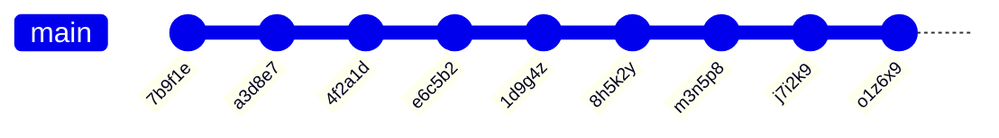

# Applied exercise: "Commit History"


The last exercise repository of the course contains exercises that deepen and apply the topics of the previous weeks. The solutions have more freedom, so you can solve them in many ways. Consider whether separate classes, stream operations or a map would help.

## Starting the exercise

First fork this repository into your own GitHub repository with GitHub's **Fork** button, and only then clone your fork to your computer:

```sh
git clone https://github.com/<your-github-username>/9-commit-history.git
```

Open the cloned project in your code editor.

## Testing

The parts of the exercise have ready-made [JUnit](https://junit.org/) unit tests in the [src/test/java](./src/test/java/) directory. Each part tells which test class grades it. You can run the tests with your code editor's testing tool ([VS Code](https://code.visualstudio.com/docs/java/java-testing), [Eclipse](https://www.vogella.com/tutorials/JUnitEclipse/article.html)) or with [Gradle](https://docs.gradle.org/current/userguide/java_testing.html), for example:

```
./gradlew test --tests CommitIdsTest        # unix
.\gradlew.bat test --tests CommitIdsTest    # windows
```

Add `--info` to the end of the command for more details about failing tests. You do not need to study how the tests are implemented, and you can also try your solution with your own `main` method. You may write more tests of your own, but do not change or remove the given tests.

Do not change the names, parameters or return types of the given classes, methods and constructors, because the tests will then not compile. You get the original version of a file back with `git restore <path to file>` or with the **Palauta lähtökoodi** (restore starter code) function of the course system.

Because the solutions have more freedom than before, you will probably need helper methods and classes. **We recommend** writing your own tests or `main` methods for them.

## Submitting and points

Each part of the exercise has its own page in the course system (https://jtjuslin.kapsi.fi/java), and its code fields contain the part's starter code. Copy your solution into the code fields or write it there directly. **Testaa ilman palautusta** (test without submitting) runs the part's tests without saving points, and **Lähetä** (submit) submits your solution. Each test class is accepted only if all of its tests pass, and the points are divided according to the accepted test classes.

**Points in two stages**

1. When your solution passes in the course system, you get **half of the points** for the part.
2. Finally, push everything to your public GitHub repository. Then press the **Lähetä tarkistettavaksi** (submit for checking) button on the part's page. When the tests pass, you get **full points** for the part. The repository may remain public.

There is no grading YAML workflow (GitHub Actions) on GitHub, and `git push` does not start any grading. When you press **Lähetä tarkistettavaksi**, the course system's bot fetches your code from your repository and checks it with the same tests. Both stages must be completed before the chapter deadline. You can submit as many times as you need, and your best result is kept.


## Git change log

Git keeps track of the changes in a repository with commits. Each commit has an author, an id, a message and a "parent" that points to the previous commit. The history of a project can be presented as text, for example like this:

```
Commit 7b9f1e by NewbieNate (Parent: None)
Initial Commit - Hello World!
Starting my coding journey. Decided to say "Hello" to the world!

Commit a3d8e7 by ProgPete (Parent: 7b9f1e)
Added comments - Explained 'Hello World'
Hey there, Nate! Added comments to your code, explaining what each line does. Welcome aboard!

Commit 4f2a1d by EagerElla (Parent: a3d8e7)
Added Function - Counting Sheep
Created a function to count sheep. Learning to make my code more functional, quite literally!

Commit e6c5b2 by LoopyLou (Parent: 4f2a1d)
Merge branch 'master' into loop-feature
Adding a loop to count sheep indefinitely. Sleepless nights led to sheep-filled code!

Commit 1d9g4z by NewbieNate (Parent: e6c5b2)
Fixed Loop Bug - Sheep now sleep
Oops! Fixed the loop. Turns out, the sheep were sleep-deprived. Now they can rest peacefully.

Commit 8h5k2y by EagerElla (Parent: 1d9g4z)
Refactor - Shepherd Class
Introduced a Shepherd class to manage the sheep better. Feeling like a digital shepherd now!

Commit m3n5p8 by ProgPete (Parent: 8h5k2y)
Documentation Update - Shepherd class explained
Documented the Shepherd class methods. Now we're herding sheep like pros!

Commit j7i2k9 by LoopyLou (Parent: m3n5p8)
Fix typo - Shepherd 'sheep' to 'sheep_count'
Typo fix! The shepherd should count the sheep_count, not the sheep itself. Phew!

Commit o1z6x9 by NewbieNate (Parent: j7i2k9)
Merge branch 'refactor' into master
Merging the refactor changes. Thanks for the help, team! Learning and growing together.
```

The data of this exercise consists of multi-line strings that present the change history of imaginary projects in this format. A larger example is in the file [commit-log-example.txt](./commit-log-example.txt). For example, a single commit with the id `d4e5f6` by the user `ohjelmointi2` could look like this:

```java
"""
Commit d4e5f6 by ohjelmointi2 (Parent: a1b2c3)
This is my comment message!
The message is two lines long...
"""
```

The "Parent" of the first commit is `None`. The other commit ids are six-character [alphanumeric](https://en.wiktionary.org/wiki/alphanumeric) strings. A commit message can have one or more lines and any special characters, including emojis. Graphically, the same history can be presented like this, for example:



> [!IMPORTANT]
> Even though the example is Git's history, **you do not need any new Git commands**. All logic is implemented with Java strings, methods and classes. Larger projects often have many branches, but this course uses only one main branch (`master` or `main`).

**Designing the solution.** It is not worth doing this exercise one part at a time. First study the whole and design reusable solutions that help in all parts. For example, your own `Commit` class may seem like extra work at first, but it pays off in the long run.


## Part 1: Commit ids *(applying, 20 %)*

Implement the `getCommitIds` method of the [CommitIds](./src/main/java/part01/CommitIds.java) class. It takes a multi-line string containing the Git log of an imaginary project in the format described above and returns the ids of the commits in the log. A detailed description is in the method's comments. You can write helper classes, such as `Commit`, in the same file.

Graded with the test class [CommitIdsTest](./src/test/java/part01/CommitIdsTest.java).


## Part 2: Contributors and statistics *(advanced, 20 % + 20 %)*

Implement the methods `getContributors` (the authors without duplicates) and `groupCommitIdsByContributors` (the commit ids by author in a map) of the [Contributors](./src/main/java/part02/Contributors.java) class according to their comments. These methods also take the Git log as a multi-line string.

Graded with the test classes [GetContributorsTest](./src/test/java/part02/GetContributorsTest.java) (half of the points) and [GroupCommitIdsTest](./src/test/java/part02/GroupCommitIdsTest.java) (half of the points).


## Part 3: reading, ordering and printing the log file *(advanced, 40 %)*

**The commits in the file [pizza-commits.txt](./pizza-commits.txt) are out of order.** Each commit tells its preceding "Parent" commit, and with them you need to print the commits in chronological order.

The program must start from the `main` method of the ready-made [part03.Main](./src/main/java/part03/Main.java) class. You may implement the internal logic freely with your own helper methods and classes, as long as:

* the program reads the commit history from the file `pizza-commits.txt` (do not modify the file),
* the program first prints the commit whose "Parent" is "None" and then each commit after its own "Parent" commit,
* each commit is printed in the same three-line format as in the file (`Commit <id> by <author> (Parent: <id>)`, title and message), and an empty line may be printed between commits, and
* the program asks for no input and prints nothing else.

You can run the program in your code editor or with `./gradlew run` (on Windows `.\gradlew.bat run`).

💡 *Even though the exercise orders commits, it cannot be solved with a sorting algorithm alone: by comparing two commits, you cannot know which one comes first unless they are each other's "parent" and "child". So apply some other method. Java's [Files](https://docs.oracle.com/en/java/javase/21/docs/api/java.base/java/nio/file/Files.html) and [Path](https://docs.oracle.com/en/java/javase/21/docs/api/java.base/java/nio/file/Path.html) classes help with reading files, and an example of using them is ready in the `main` method template.*

💡 *The project files are saved in UTF-8. If you have problems with character encodings, make sure that both your code and your editor use the right encoding. On Windows, you can set Eclipse's encoding [as shown in this image](https://ohjelmointi2.github.io/img/eclipse-workspace-encoding.jpg).*

Graded with the test class [PizzaCommitsTest](./src/test/java/part03/PizzaCommitsTest.java), which runs the `main` method and checks the order of the output lines.


## License and authors

This exercise was developed by Teemu Havulinna and Jukka Juslin, and it is licensed under the [Creative Commons BY-NC-SA license](https://creativecommons.org/licenses/by-nc-sa/4.0/). ChatGPT 3.5 and GitHub Copilot were used in creating the assignment, the source code and the tests. The commit log files of the exercise were created with the help of ChatGPT 3.5.
