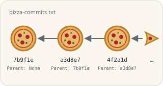
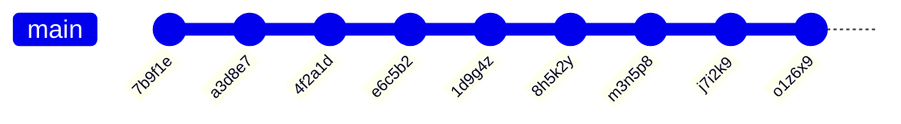

> [!NOTE]
> The English translation for this exercise can be found in [this file](./readme.en.md).

# Soveltava tehtävä: "Commit History"



Tämä kurssin viimeinen tehtävärepositorio sisältää harjoituksia, joilla syvennetään ja sovelletaan aiempien viikkojen aiheita. Ratkaisuille on annettu enemmän vapauksia, joten voit ratkaista ne monella tavalla. Pohdi, olisiko erillisistä luokista, stream-operaatioista tai map-tietorakenteesta apua.

## Tehtävän aloittaminen

Forkkaa ensin tämä repositorio omaan GitHub-repositorioosi GitHubin **Fork**-painikkeella ja kloonaa vasta sitten oma forkkisi koneellesi:

```sh
git clone https://github.com/<oma-github-tunnuksesi>/9-commit-history.git
```

Avaa kloonattu projekti koodieditorissasi.

## Testaaminen

Tehtävän osille on valmiit [JUnit](https://junit.org/)-yksikkötestit hakemistossa [src/test/java](./src/test/java/). Kunkin osan kohdalla kerrotaan, millä testiluokalla se arvioidaan. Voit ajaa testit koodieditorisi testaustyökalulla ([VS Code](https://code.visualstudio.com/docs/java/java-testing), [Eclipse](https://www.vogella.com/tutorials/JUnitEclipse/article.html)) tai [Gradlella](https://docs.gradle.org/current/userguide/java_testing.html), esimerkiksi:

```
./gradlew test --tests CommitIdsTest        # unix
.\gradlew.bat test --tests CommitIdsTest    # windows
```

Lisää komennon loppuun `--info`, jos haluat tarkemmat tiedot epäonnistuneista testeistä. Testien tekniseen toteutukseen ei tarvitse perehtyä, ja voit kokeilla ratkaisuasi myös omalla `main`-metodilla. Saat kirjoittaa omia testejä lisää, mutta älä muuta tai poista valmiita testejä.

Älä muuta valmiiden luokkien, metodien ja konstruktorien nimiä, parametreja tai paluuarvojen tyyppejä, sillä silloin testit eivät käänny. Saat tiedoston alkuperäisen version takaisin komennolla `git restore <tiedoston polku>` tai kurssijärjestelmän **Palauta lähtökoodi** -toiminnolla.

Koska ratkaisuille on annettu aiempaa enemmän vapauksia, tarvitset todennäköisesti apumetodeja ja -luokkia. **Suosittelemme** kirjoittamaan niille omia testejä tai `main`-metodeja.

## Palauttaminen ja pisteet

Jokaisella tehtävän osalla on kurssijärjestelmässä (https://jtjuslin.kapsi.fi/java) oma sivunsa, jonka koodikentissä on osan koodipohja. Kopioi ratkaisusi koodikenttiin tai kirjoita se suoraan niihin. **Testaa ilman palautusta** ajaa osan testit tallentamatta pisteitä, ja **Lähetä** palauttaa ratkaisun. Jokainen testiluokka hyväksytään vain, jos sen kaikki testit menevät läpi, ja pisteet jaetaan hyväksyttyjen testiluokkien mukaan.

**Pisteet kahdessa vaiheessa**

1. Kun ratkaisusi menee läpi kurssijärjestelmässä, saat osasta **puolet pisteistä**.
2. Pushaa lopuksi kaikki julkiseen GitHub-repositorioosi. Paina tämän jälkeen osan sivulla **Lähetä tarkistettavaksi** -nappia. Kun testit menevät läpi, saat osasta **täydet pisteet**. Repositorio saa jäädä julkiseksi.

GitHubissa ei ole arvioivaa YAML-tehtävävirtaa (GitHub Actions -workflowta), eikä `git push` käynnistä arviointia. Kun painat **Lähetä tarkistettavaksi**, kurssijärjestelmän botti hakee koodisi repositoriostasi ja tarkistaa sen samoilla testeillä. Molemmat vaiheet pitää tehdä ennen luvun määräaikaa. Voit lähettää ratkaisusi niin monta kertaa kuin tarvitset, ja voimaan jää paras tulos.


## Gitin muutoslogi

Git pitää kirjaa repositorion muutoksista committien avulla. Kullakin commitilla on tekijä, id, viesti sekä "parent", joka osoittaa edeltävään committiin. Projektin historia voidaan esittää tekstimuodossa esimerkiksi näin:

```
Commit 7b9f1e by NewbieNate (Parent: None)
Initial Commit - Hello World!
Starting my coding journey. Decided to say "Hello" to the world!

Commit a3d8e7 by ProgPete (Parent: 7b9f1e)
Added comments - Explained 'Hello World'
Hey there, Nate! Added comments to your code, explaining what each line does. Welcome aboard!

Commit 4f2a1d by EagerElla (Parent: a3d8e7)
Added Function - Counting Sheep
Created a function to count sheep. Learning to make my code more functional, quite literally!

Commit e6c5b2 by LoopyLou (Parent: 4f2a1d)
Merge branch 'master' into loop-feature
Adding a loop to count sheep indefinitely. Sleepless nights led to sheep-filled code!

Commit 1d9g4z by NewbieNate (Parent: e6c5b2)
Fixed Loop Bug - Sheep now sleep
Oops! Fixed the loop. Turns out, the sheep were sleep-deprived. Now they can rest peacefully.

Commit 8h5k2y by EagerElla (Parent: 1d9g4z)
Refactor - Shepherd Class
Introduced a Shepherd class to manage the sheep better. Feeling like a digital shepherd now!

Commit m3n5p8 by ProgPete (Parent: 8h5k2y)
Documentation Update - Shepherd class explained
Documented the Shepherd class methods. Now we're herding sheep like pros!

Commit j7i2k9 by LoopyLou (Parent: m3n5p8)
Fix typo - Shepherd 'sheep' to 'sheep_count'
Typo fix! The shepherd should count the sheep_count, not the sheep itself. Phew!

Commit o1z6x9 by NewbieNate (Parent: j7i2k9)
Merge branch 'refactor' into master
Merging the refactor changes. Thanks for the help, team! Learning and growing together.
```

Tehtävän data koostuu monirivisistä merkkijonoista, jotka esittävät kuvitteellisten projektien muutoshistoriaa tässä muodossa. Laajempi esimerkki on tiedostossa [commit-log-example.txt](./commit-log-example.txt). Esimerkiksi käyttäjän `ohjelmointi2` yksittäinen commit, jonka id on `d4e5f6`, voisi näyttää tältä:

```java
"""
Commit d4e5f6 by ohjelmointi2 (Parent: a1b2c3)
This is my comment message!
The message is two lines long...
"""
```

Ensimmäisen commitin "Parent" on `None`. Muut commit-id:t ovat kuuden merkin pituisia [aakkosnumeerisia](https://fi.wiktionary.org/wiki/aakkosnumeerinen) merkkijonoja. Commit-viestissä voi olla yksi tai useampi rivi ja mitä tahansa erikoismerkkejä, myös emojeja. Graafisesti sama historia voidaan esittää esimerkiksi näin:



> [!IMPORTANT]
> Vaikka esimerkkinä on Gitin historia, **sinun ei tarvitse käyttää uusia Git-komentoja**. Kaikki logiikka toteutetaan Javan merkkijonoilla, metodeilla ja luokilla. Isommissa projekteissa on usein monta kehityshaaraa, mutta tällä kurssilla käytetään vain yhtä pääkehityshaaraa (`master` tai `main`).

**Ratkaisun suunnittelu.** Tätä tehtävää ei kannata tehdä osa kerrallaan, vaan perehdy ensin kokonaisuuteen ja suunnittele uudelleenkäytettävät ratkaisut, jotka auttavat kaikissa osissa. Esimerkiksi oma `Commit`-luokka voi tuntua aluksi ylimääräiseltä työltä, mutta se kannattaa pidemmän päälle.


## Osa 1: Commit ids *(soveltava, 20 %)*

Toteuta [CommitIds](./src/main/java/part01/CommitIds.java)-luokan metodi `getCommitIds`. Se saa parametrinaan monirivisen merkkijonon, jossa on kuvitteellisen projektin Git-loki yllä kuvatussa muodossa, ja palauttaa lokin committien id:t. Tarkempi kuvaus on metodin kommenteissa. Voit kirjoittaa apuluokkia, kuten `Commit`, samaan tiedostoon.

Arvioinnissa ajetaan testiluokka [CommitIdsTest](./src/test/java/part01/CommitIdsTest.java).


## Osa 2: Contributors and statistics *(edistynyt, 20 % + 20 %)*

Toteuta [Contributors](./src/main/java/part02/Contributors.java)-luokan metodit `getContributors` (tekijät ilman toistoja) ja `groupCommitIdsByContributors` (commit-id:t tekijöittäin mapissa) niiden kommenttien mukaisesti. Myös nämä metodit saavat parametrinaan Git-lokin monirivisenä merkkijonona.

Arvioinnissa ajetaan testiluokat [GetContributorsTest](./src/test/java/part02/GetContributorsTest.java) (puolet pisteistä) ja [GroupCommitIdsTest](./src/test/java/part02/GroupCommitIdsTest.java) (puolet pisteistä).


## Osa 3: lokitiedoston lukeminen, järjestäminen ja tulostaminen *(edistynyt, 40 %)*

Tiedoston [pizza-commits.txt](./pizza-commits.txt) **commitit ovat epäjärjestyksessä**. Jokaisessa commitissa on tieto edeltävästä "Parent"-commitista, ja niiden avulla sinun tulee tulostaa commitit kronologisessa järjestyksessä.

Ohjelman pitää käynnistyä valmiin [part03.Main](./src/main/java/part03/Main.java)-luokan `main`-metodista. Sisäisen logiikan saat toteuttaa vapaasti omilla apumetodeilla ja -luokilla, kunhan:

* ohjelma lukee commit-historian tiedostosta `pizza-commits.txt` (tiedostoa ei saa muokata),
* ohjelma tulostaa ensin commitin, jonka "Parent" on "None", ja sen jälkeen jokaisen commitin oman "Parent"-commitinsa jälkeen,
* jokainen commit tulostetaan samassa kolmirivisessä muodossa kuin tiedostossa (`Commit <id> by <tekijä> (Parent: <id>)`, otsikko ja viesti), ja committien väliin saa tulostaa tyhjän rivin, ja
* ohjelma ei kysy syötteitä eikä tulosta mitään muuta.

Voit suorittaa ohjelman koodieditorissasi tai komennolla `./gradlew run` (Windowsissa `.\gradlew.bat run`).

💡 *Vaikka tehtävässä järjestetään committeja, sitä ei voi ratkaista pelkällä lajittelualgoritmilla: kahta committia vertaamalla ei voi tietää, kumpi on ensin, elleivät ne ole toistensa "parent" ja "child". Sovella siis jotain muuta menetelmää. Tiedostojen lukemisessa auttavat Javan [Files](https://docs.oracle.com/en/java/javase/21/docs/api/java.base/java/nio/file/Files.html)- ja [Path](https://docs.oracle.com/en/java/javase/21/docs/api/java.base/java/nio/file/Path.html)-luokat, ja esimerkki niiden käytöstä on valmiina `main`-metodin pohjassa.*

💡 *Projektin tiedostot on tallennettu UTF-8-merkistöllä. Jos merkistöjen kanssa on ongelmia, varmista, että koodissa ja editorissa on oikea merkistö. Eclipsen merkistön voi Windowsissa asettaa [tämän kuvan mukaisesti](https://ohjelmointi2.github.io/img/eclipse-workspace-encoding.jpg).*

Arvioinnissa ajetaan testiluokka [PizzaCommitsTest](./src/test/java/part03/PizzaCommitsTest.java), joka ajaa `main`-metodin ja tarkistaa tulosteen rivien järjestyksen.


## Lisenssi ja tekijät

Tämän tehtävän ovat kehittäneet Teemu Havulinna ja Jukka Juslin, ja se on lisensoitu [Creative Commons BY-NC-SA -lisenssillä](https://creativecommons.org/licenses/by-nc-sa/4.0/). Tehtävänannon, lähdekoodien ja testien toteutuksessa on hyödynnetty ChatGPT 3.5 -kielimallia sekä GitHub Copilot -tekoälyavustinta. Tehtävän commit log -tiedostot on luotu ChatGPT 3.5:n avulla.
